<p align="center">
  
</p>

<p align="center">
  
  
  
  
  
</p>

<h3 align="center">Un equipo de siete agentes de IA que vive en un dock flotante de tu Mac.</h3>

Daily Office es una app nativa de macOS (SwiftUI + AppKit). Cada agente tiene su propia ventana, su historial y su método de trabajo. Funcionan con tu sesión local de **Codex** o con claves de API (OpenAI, Anthropic, Gemini, NVIDIA, xAI o un endpoint compatible).

> **Equipo:** CEO · Marketing · Desarrollador · Creativo · Chequeador · Diseñador · Redactor

---

## Cómo se usa

### 1 · Abre un agente desde el dock

<p align="center"></p>

Acerca el cursor a la pestaña del dock, haz clic en un agente y escribe tu encargo. Envía con `⌘ ↩`.

### 2 · Conecta una carpeta de proyecto

<p align="center"></p>

Elige la carpeta de tu proyecto, entra en él y pulsa **Ejecutar proyecto** para correrlo desde Daily Office.

### 3 · Deja que el CEO reparta el trabajo

<p align="center"></p>

Activa **Delegar al equipo** en el chat del CEO. Planifica hasta cinco encargos, los ejecuta uno tras otro con los especialistas y evalúa las entregas.

### 4 · Envía una captura de pantalla

<p align="center"></p>

Pulsa el visor del chat, elige una región (o una ventana con la barra espaciadora) y el agente analiza la captura. El modelo elegido debe admitir imágenes.

---

## Qué incluye

| Función | Detalle |
|---|---|
| Siete agentes | CEO, Marketing, Desarrollador, Creativo, Chequeador, Diseñador y Redactor, cada uno con instrucciones y skill propias |
| Dock flotante | Pestaña discreta que se despliega al acercar el cursor; icono en la barra de menús |
| Conversaciones independientes | Un historial por agente que se conserva al cerrar la ventana |
| Delegación | El CEO reparte hasta 5 encargos secuenciales y evalúa los resultados |
| Proveedores | Codex local, OpenAI, Anthropic, Gemini, NVIDIA, xAI y endpoints compatibles |
| Captura de pantalla | Selector nativo de macOS; la captura se adjunta antes de enviar |
| Proyectos | Carpeta, contexto compartido y botón para ejecutarlo en Terminal |
| Skills | Se pueden activar, quitar o importar desde un `SKILL.md` |
| Privacidad | Las claves viven en el Llavero de macOS; los datos, en tu Mac |

---

## Instalación

Necesitas un Mac con macOS 14 o posterior, Xcode y Git. Probado con Xcode 27; debería funcionar con Xcode 15.3 o posterior, aunque no está verificado.

```sh
git clone https://github.com/emilianocros27-bit/Daily-Office.git
cd Daily-Office
xcodebuild -project DailyOffice.xcodeproj -scheme DailyOffice -configuration Release -derivedDataPath build CODE_SIGNING_ALLOWED=NO build
cp -R "build/Build/Products/Release/Daily Office.app" /Applications/
xattr -dr com.apple.quarantine "/Applications/Daily Office.app"
open "/Applications/Daily Office.app"
```

También puedes abrir `DailyOffice.xcodeproj` en Xcode y ejecutar el esquema **DailyOffice**.

Para usar **Codex** (opcional):

```sh
npm install -g @openai/codex
codex login
```

La app busca `codex` en `/opt/homebrew/bin`, `/usr/local/bin`, `~/.npm-global/bin`, `~/.local/bin` y `~/.bun/bin`.

## Permisos

| Permiso | Para qué | Cuándo aparece |
|---|---|---|
| Grabación de pantalla | Capturar la región que eliges | La primera vez que pulsas el visor |
| Automatización (Terminal) | Ejecutar el comando de tu proyecto | La primera vez que pulsas «Ejecutar proyecto» |
| Llavero | Guardar tus claves de API | Al guardar una clave |
| Sesión de Codex | Trabajar con tu cuenta de Codex | Al ejecutar `codex login` |

No hay vigilancia continua ni grabación de audio. No hay cuentas ni colaboración en la nube.

## Personalizar

| Quieres cambiar | Archivo |
|---|---|
| Nombre, color, icono e instrucciones de cada agente | `DailyOffice/Models.swift` |
| Skills predeterminadas | `DailyOffice/DefaultSkills.json` y la carpeta `Skills/` (luego `python3 make_skills.py`) |
| Proveedores de API y URLs base | `DailyOffice/Services.swift` |
| Rutas donde se busca Codex | `CodexLocator` en `DailyOffice/Models.swift` |
| Nombre de la app, identificador, versión y permisos | `generate_project.py` (luego `python3 generate_project.py`) |
| Interfaz del dock y los chats | `DailyOffice/MainView.swift` y `DailyOffice/Views.swift` |

## Si algo falla

| Problema | Solución |
|---|---|
| «No se encontró Codex» | Ejecuta `which codex` y comprueba que esté en una de las rutas anteriores; si no, `npm install -g @openai/codex` |
| Codex pide iniciar sesión | `codex login` y pulsa **Comprobar conexión** en General |
| macOS dice que la app está dañada o no verificada | `xattr -dr com.apple.quarantine "/Applications/Daily Office.app"` |
| La captura sale vacía | Ajustes del Sistema → Privacidad y seguridad → Grabación de pantalla → activa Daily Office y reabre la app |
| «Ejecutar proyecto» no hace nada | Ajustes del Sistema → Privacidad y seguridad → Automatización → permite a Daily Office controlar Terminal |
| Una API responde con error | Revisa el identificador exacto del modelo, la URL base (con `/v1` si corresponde) y la clave |
| El build falla | Abre el proyecto en Xcode, elige tu Mac como destino y revisa el primer error |

## O deja que Claude lo haga

Pega esto en Claude Code:

```text
Instala Daily Office en mi Mac siguiendo las instrucciones de https://github.com/emilianocros27-bit/Daily-Office/blob/main/CLAUDE.md
```

## Datos y límites

- Datos en `~/Library/Application Support/DailyOffice/office.json`, con escritura atómica y copia de recuperación si se daña. El respaldo JSON no incluye claves ni imágenes.
- Los turnos tienen un límite de diez minutos; puedes continuar con otro mensaje.
- Un solo agente con permiso de escritura puede trabajar a la vez. La edición está desactivada de forma inicial y se activa por agente.
- Las APIs externas admiten conversación e imágenes, sin herramientas de archivos ni terminal.
- Las skills comunitarias (copywriting y seo-audit de coreyhaines31/marketingskills; frontend-design y skill-creator de Anthropic) quedan fijadas en este proyecto y conservan sus licencias.

## Desarrollo

```sh
swift test
```

Las pruebas cubren persistencia, aislamiento, pausa y desactivación, recuperación, transporte Codex, coordinación del CEO y rechazo de HTTP remoto. Consulta `VALIDATION.md` para el estado de la última validación.

## Licencia

[MIT](LICENSE)
